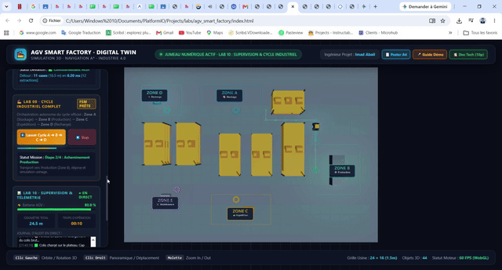
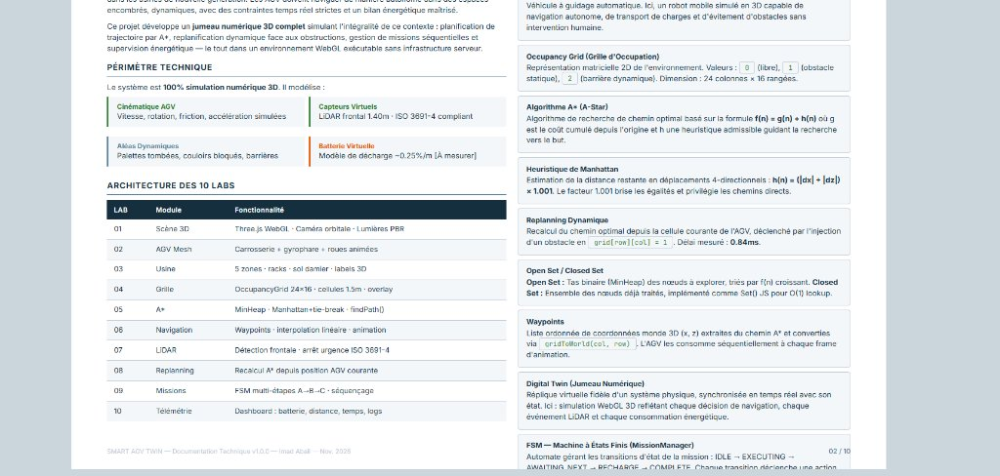
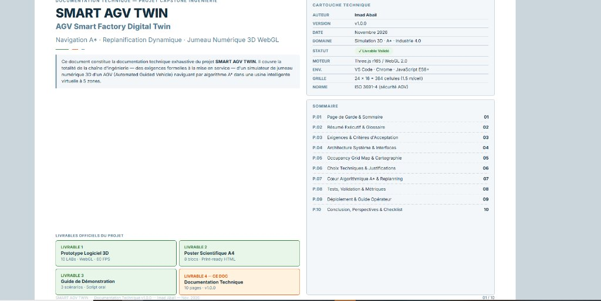
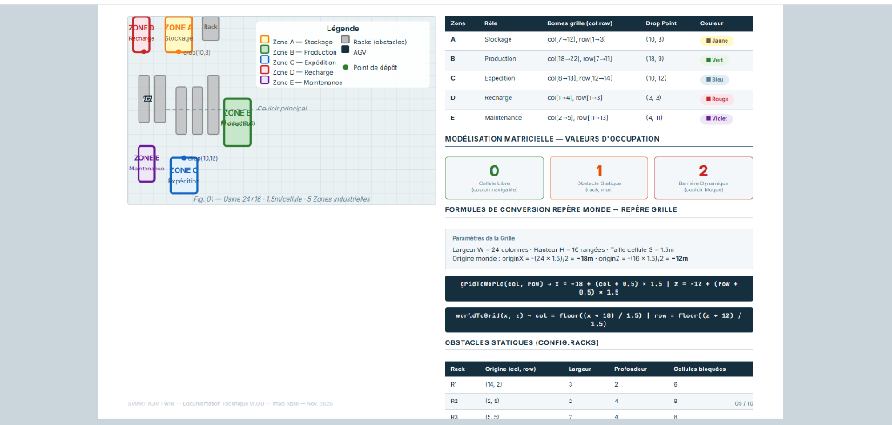
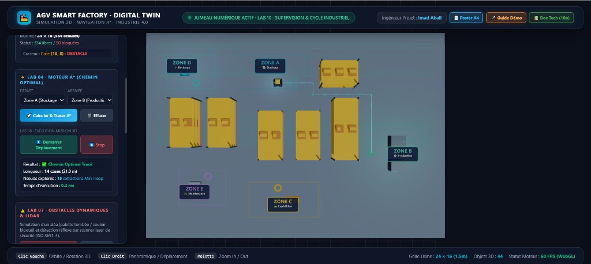
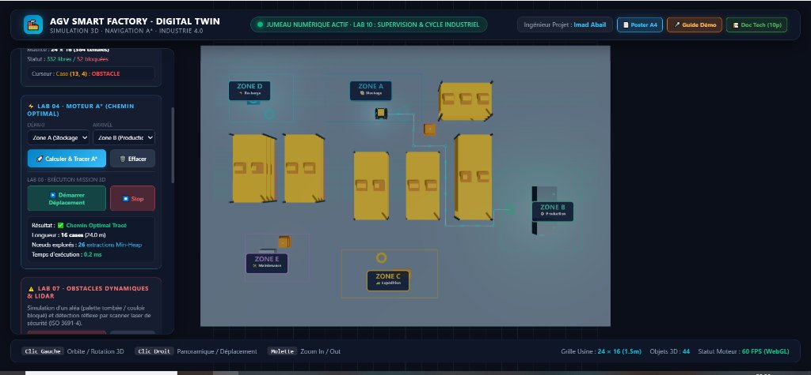
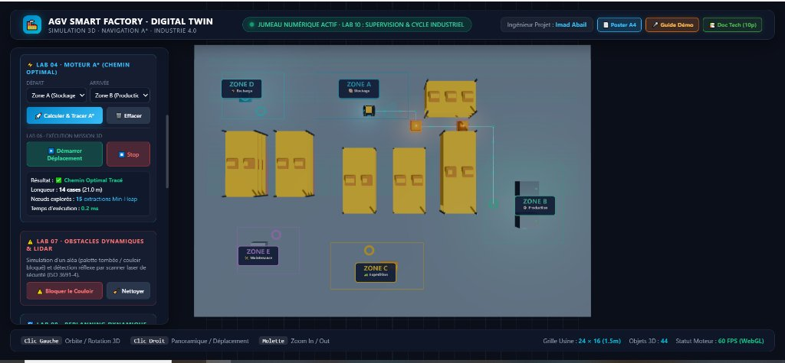
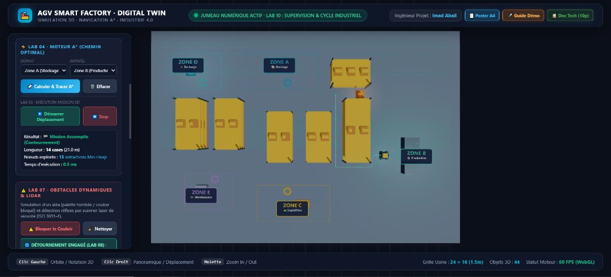
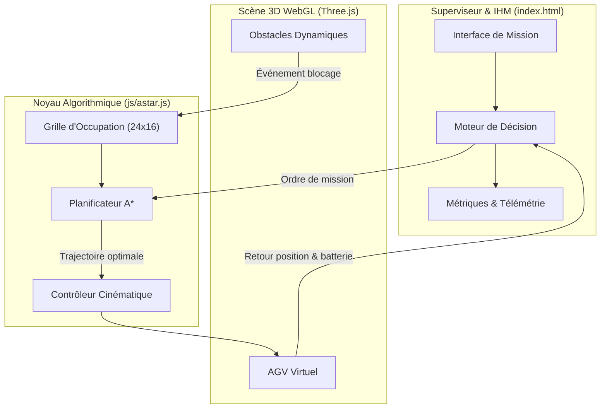

# 🏭 SMART AGV TWIN — AGV Smart Factory Digital Twin

[](https://threejs.org/)
[](https://www.khronos.org/webgl/)
[]()
[]()
[]()
[]()

> **Projet de simulation 3D · Algorithme A* · Planification intelligente · Industrie 4.0**  
> Système intelligent de transport autonome par AGV (Automated Guided Vehicle) évoluant dans un jumeau numérique 3D d'usine logistique avec évitement dynamique d'obstacles, supervision temps réel et gestion énergétique.

---

## 🎬 Vidéo de Démonstration 3D en Temps Réel

[](demos/agv_smart_factory_digital_twin_demo.mp4)

* 📹 **Fichier Vidéo HD (Dépôt) :** [`demos/agv_smart_factory_digital_twin_demo.mp4`](demos/agv_smart_factory_digital_twin_demo.mp4) (H.264 1080p, 60 FPS)
* ☁️ **Lien Vidéo Streaming (Google Drive) :** [Visionner la Démonstration Complète sur Google Drive](https://drive.google.com/file/d/1QBTXK71XloV39bOKSFlTwr2kRLdPn0ex/view?usp=drivesdk)

---

## 📸 Aperçu & Interface du Jumeau Numérique

### 🏭 Supervision Générale & Livrables

| Vue d'Ensemble de l'Usine 3D (36m × 24m) | Algorithme A* & Replanification Dynamique |
| :---: | :---: |
|  |  |
| **5 Zones interconnectées, 6 racks industriels R1–R6** et couloirs logistiques normalisés. | **Détection d'obstacle par capteurs virtuels** et recalcul immédiat du chemin optimal sans collision. |

| Arrivée et Dépose en Zone B (Production) | Architecture & Livrables Pédagogiques |
| :---: | :---: |
|  |  |
| **Accostage millimétrique, gestion de charge utile** et mise à jour d'état FSM en temps réel. | **Suite complète de livrables :** Simulateur 3D WebGL, Documentation 10 pages, Guide de démo, Poster. |

### 🔬 Cycle Complet de Navigation A* & Évitement d'Obstacle (Captures In-Situ)

| Étape 1 : Calcul du Trajet Optimal Nominal | Étape 2 : Blocage Couloir & Détection LiDAR |
| :---: | :---: |
|  |  |
| **Trajet direct Zone A $\to$ Zone B (14 cases, 21.0 m)** calculé en **0.2 ms** via Min-Heap. | **Injection d'un obstacle imprévu en case (13, 4)** et détection réflexe par LiDAR virtuel. |

| Étape 3 : Replanification Instantanée & Détour | Étape 4 : Mission Accomplie en Zone B |
| :---: | :---: |
|  |  |
| **Recalcul automatique d'une trajectoire sécurisée** contournant l'allée bloquée sans arrêt prolongé. | **Accostage réussi à la station cible de production** avec validation FSM et archivage de mission. |

---

## 📑 Sommaire
1. [Présentation du Projet & Périmètre](#01-présentation-du-projet--périmètre)
2. [Environnement du Jumeau Numérique (5 Zones & Racks)](#02-environnement-du-jumeau-numérique)
3. [Réalisation en 10 LABs Pédagogiques](#03-réalisation-en-10-labs-pédagogiques)
4. [Algorithme de Navigation A* & Évitement](#04-algorithme-de-navigation-a--évitement)
5. [Architecture Fonctionnelle & Machine à États (FSM)](#05-architecture-fonctionnelle--machine-à-états-fsm)
6. [Scénario de Démonstration pour Soutenance](#06-scénario-de-démonstration-pour-soutenance)
7. [Structure de l'Espace de Travail](#07-structure-de-lespace-de-travail)
8. [Lancement Rapide (Quick Start)](#08-lancement-rapide-quick-start)
9. [Livrables Inclus](#09-livrables-inclus)
10. [Auteur & Contact](#10-auteur--contact)

---

## 01. Présentation du Projet & Périmètre

Le projet **SMART AGV TWIN** a pour objectif de concevoir, implémenter et déployer un **Jumeau Numérique 3D temps réel** pour la supervision et le pilotage d'un chariot à guidage automatique (**AGV**) en environnement manufacturier et logistique.

* **Périmètre :** Le projet se déroule à **100 % en simulation logicielle**. Le robot mobile, ses capteurs (LiDAR de sécurité, odométrie), la carte d'occupation et les perturbations extérieures sont intégralement simulés.
* **Mission Principale :** Réception d'ordres de transport complexes (prise de colis en **Zone A - Stockage**, transit sécurisé dans les couloirs, dépose en **Zone B - Production**), gestion des priorités et adaptation de trajectoire en cas d'imprévu.

---

## 02. Environnement du Jumeau Numérique

L'environnement simule un atelier d'assemblage et de stockage moderne de **36 m × 24 m** discrétisé en grille unitaire ($1\,\text{m} \times 1\,\text{m}$) :

| Zone | Dénomination | Rôle & Fonction Opérationnelle | Coordonnées Grille |
| :---: | :--- | :--- | :---: |
| **Zone A** | **Stockage** | Récupération virtuelle des colis et matières premières | $(1..7,\, 17..21)$ |
| **Zone B** | **Production** | Alimentation des lignes de fabrication et machines-outils | $(17..23,\, 2..6)$ |
| **Zone C** | **Expédition** | Évacuation et palettisation des produits finis vers quais | $(1..7,\, 2..6)$ |
| **Zone D** | **Recharge** | Docks de charge par induction avec retour automatique | $(17..23,\, 17..21)$ |
| **Zone E** | **Maintenance** | Poste de diagnostic, supervision et banc de maintenance | $(9..15,\, 17..21)$ |

* **Rayonnages R1 à R6 :** 6 racks de stockage double face de $2{,}7\,\text{m} \times 1{,}1\,\text{m}$ disposés le long de l'allée centrale, déclarés comme obstacles statiques infranchissables.
* **Couloirs logistiques :** Voies de circulation à double sens avec signalisation au sol jaune/noir et dégagements de sécurité.

---

## 03. Réalisation en 10 LABs Pédagogiques

Le projet valide l'ensemble des compétences du référentiel à travers **10 LABs structurés** :

| LAB | Titre du LAB | Résultat Technique Obtenu |
| :---: | :--- | :--- |
| **LAB 01** | **Création de l'usine 3D** | Scène Three.js modélisant les 5 zones, marquages au sol, racks R1–R6 et éclairage. |
| **LAB 02** | **Modélisation de l'AGV** | Robot mobile avec châssis biseauté, roues polyuréthane, balise et LiDAR animés. |
| **LAB 03** | **Occupancy Grid Map** | Matrice navigable discrète (valeurs : `0 = libre`, `1 = obstacle`, `2 = tampon`). |
| **LAB 04** | **Implémentation A\*** | Calcul de chemin optimal à coût minimal avec distance de Manhattan. |
| **LAB 05** | **Visualisation du chemin** | Tracé de trajectoire 3D en ruban néon vert/cyan et waypoints interactifs. |
| **LAB 06** | **Simulation du mouvement** | Interpolation cinématique douce, orientation angulaire et gestion d'accélération. |
| **LAB 07** | **Obstacles dynamiques** | Injection en temps réel de palettes ou barrières bloquant les cellules du couloir. |
| **LAB 08** | **Replanning avec A\*** | Détection par LiDAR virtuel et recalcul instantané d'une déviation sécurisée. |
| **LAB 09** | **Missions multiples** | File d'attente d'ordres séquentiels ($A \to B \to C \to D$) avec gestion de priorité. |
| **LAB 10** | **Supervision & Performance** | Dashboard temps réel : télémétrie, état batterie, compteur de recalculs et logs FSM. |

---

## 04. Algorithme de Navigation A* & Évitement

### Formulation Mathématique
L'évaluation de priorité pour chaque cellule candidate $n$ repose sur la fonction de coût standard :

$$f(n) = g(n) + h(n)$$

* $g(n)$ : Coût exact accumulé depuis le point de départ jusqu'au nœud $n$.
* $h(n)$ : Heuristique admissible estimant le coût restant jusqu'au but (Distance de Manhattan) :
  $$h(n) = |x_n - x_{\text{cible}}| + |y_n - y_{\text{cible}}|$$
* $f(n)$ : Priorité d'exploration (la file avec priorité extrait en permanence le nœud de $f$ minimal).

```
 0  1  2  3  4  5  6  7  8  9 10 11 12
0 .  .  .  .  .  .  .  .  .  .  .  .  .
1 .  .  ██ .  .  .  ██ .  .  .  .  .  .
2 [S] .  .  .  .  .  ██ .  .  .  .  . [G]  <-- Trajet optimal : 16 pas
3 .  ██ .  .  .  .  ██ .  .  ██ .  .  .
4 .  ██ .  .  .  .  .  .  .  ██ .  .  .
5 .  .  .  ██ ██ .  .  .  .  .  .  .  .
```

### Replanification Dynamique (Dynamic Replanning)
Lorsqu'un obstacle imprévu (carton tombé, fermeture de couloir) survient sur la cellule courante $+ 1$ :
1. Le capteur LiDAR virtuel signale un blocage d'allée.
2. La matrice d'occupation est immédiatement actualisée (`grid[x][y] = 1`).
3. Le planificateur relance $A^*$ avec pour nouveau point de départ la position courante de l'AGV.
4. L'AGV contourne l'obstacle sans interruption brutale et sans retour au point d'origine.

---

## 05. Architecture Fonctionnelle & Machine à États (FSM)



### Machine à États Finis (FSM 6 États)
* `IDLE` : Robot à l'arrêt, en attente de commande.
* `NAVIGATING` : Déplacement guidé par les waypoints du chemin $A^*$.
* `BLOCKED` : Détection d'obstacle par le balayage de sécurité LiDAR.
* `REPLANNING` : Recalcul algorithmique d'une nouvelle trajectoire.
* `DOCKING` : Manœuvre d'accostage et dépose/prise de charge.
* `CHARGING` : Recharge de la batterie aux bornes d'induction de la Zone D.

---

## 06. Scénario de Démonstration pour Soutenance

Le simulateur intègre un scénario type de démonstration en 3 phases :
1. **Phase 1 — Enchaînement séquentiel de missions :** Transport consécutif de trois colis entre les stations $A \to B \to C$.
2. **Phase 2 — Perturbation en cours de route :** Fermeture inopinée du couloir principal lors de la deuxième livraison. Le superviseur détecte l'obstacle, l'AGV actualise sa carte, recalcule sa route par l'allée centrale et poursuit sans encombre.
3. **Phase 3 — Gestion de fin de mission & énergie :** Dépose du dernier colis, vérification du seuil de batterie ($SOC < 30\%$) et retour autonome vers la station de recharge par induction (Zone D).

---

## 07. Structure de l'Espace de Travail

```text
agv_smart_factory/
├── index.html                           # Simulateur 3D interactif WebGL & Dashboard
├── Documentation_Technique_SMART_AGV_TWIN.html # Dossier technique A4 Paysage (10 pages)
├── Guide_Demo_AGV_Twin.html             # Guide de démonstration et soutenance
├── Poster_AGV_Smart_Factory.html        # Poster académique grand format
│
├── css/
│   └── style.css                        # Styles responsive & UI Glassmorphism
│
├── js/
│   ├── app.js                           # Contrôleur principal & liaison des événements
│   ├── config.js                        # Constantes usine, 5 zones, 6 racks, I/O
│   ├── grid.js                          # Occupancy Grid Map 2D (0, 1, 2)
│   ├── astar.js                         # Algorithme A* et replanning dynamique
│   ├── factory.js                       # Scène usine 3D Three.js, sol, marquages
│   ├── agv.js                           # Modèle cinématique de l'AGV, odométrie
│   ├── dynamic_obstacles.js             # Gestionnaire d'obstacles et blocages
│   ├── path_visualizer.js               # Tracé 3D du chemin lumineux & waypoints
│   ├── mission_manager.js               # FSM 6 états, file d'attente de missions
│   └── rescue_swarm_model.js            # Modèle géométrique procédural de secours
│
├── lib/
│   ├── three.min.js                     # Moteur 3D WebGL Three.js (r160)
│   └── OrbitControls.js                 # Contrôle de caméra orbitale 3D
│
├── models/
│   ├── agv_rescue_swarm.glb             # Modèle 3D optimisé glTF/GLB
│   ├── agv_rescue_swarm.obj             # Export Wavefront OBJ
│   └── agv_rescue_swarm.stl             # Export stéréolithographie STL
│
├── screenshots/                         # Captures d'écran & figures de documentation
│   ├── 00_livrables_capstone.png
│   ├── 01_usine_plan_2d.jpg
│   ├── 02_astar_replanning.jpg
│   └── 03_zone_b_production.png
│
├── .gitignore                           # Exclusion stricte des fichiers Blender & vidéos
└── README.md                            # Documentation complète du dépôt GitHub
```

---

## 08. Lancement Rapide (Quick Start)

Le simulateur est conçu en **pure technologie Web standard (Zero-Build)** sans nécessiter `npm`, `node_modules` ni bundler :

1. **Cloner le dépôt :**
   ```bash
   git clone https://github.com/imadabail08-hue/AGV_Smart_Factory_Digital_Twin.git
   cd AGV_Smart_Factory_Digital_Twin
   ```
2. **Exécuter :**
   * Double-cliquez directement sur **`index.html`** dans votre navigateur (Chrome, Firefox, Edge).
   * Ou lancez un serveur local léger (recommandé pour le chargement des modèles 3D) :
     ```bash
     python -m http.server 8080
     ```
     Puis ouvrez [`http://localhost:8080`](http://localhost:8080).

---

## 09. Livrables Inclus

* 🎮 **Simulateur 3D Interactif :** [`index.html`](index.html)
* 📖 **Dossier Technique Complet (10 Pages A4 Paysage) :** [`Documentation_Technique_SMART_AGV_TWIN.html`](Documentation_Technique_SMART_AGV_TWIN.html)
* 📋 **Guide de Démonstration (Soutenance) :** [`Guide_Demo_AGV_Twin.html`](Guide_Demo_AGV_Twin.html)
* 🎨 **Poster Scientifique / Infographie :** [`Poster_AGV_Smart_Factory.html`](Poster_AGV_Smart_Factory.html)

---

## 10. Auteur & Contact

* **Auteur :** **Imad Abail** (Promotion 2026)
* **GitHub :** [@imadabail08-hue](https://github.com/imadabail08-hue) / [@imadabail08-cpu](https://github.com/imadabail08-cpu)
* **Email :** imadabail08@gmail.com
* **Cadre :** Grand Projet de Fin d'Études (Capstone Project) — Ingénierie des Systèmes Intelligents & Industrie 4.0.
